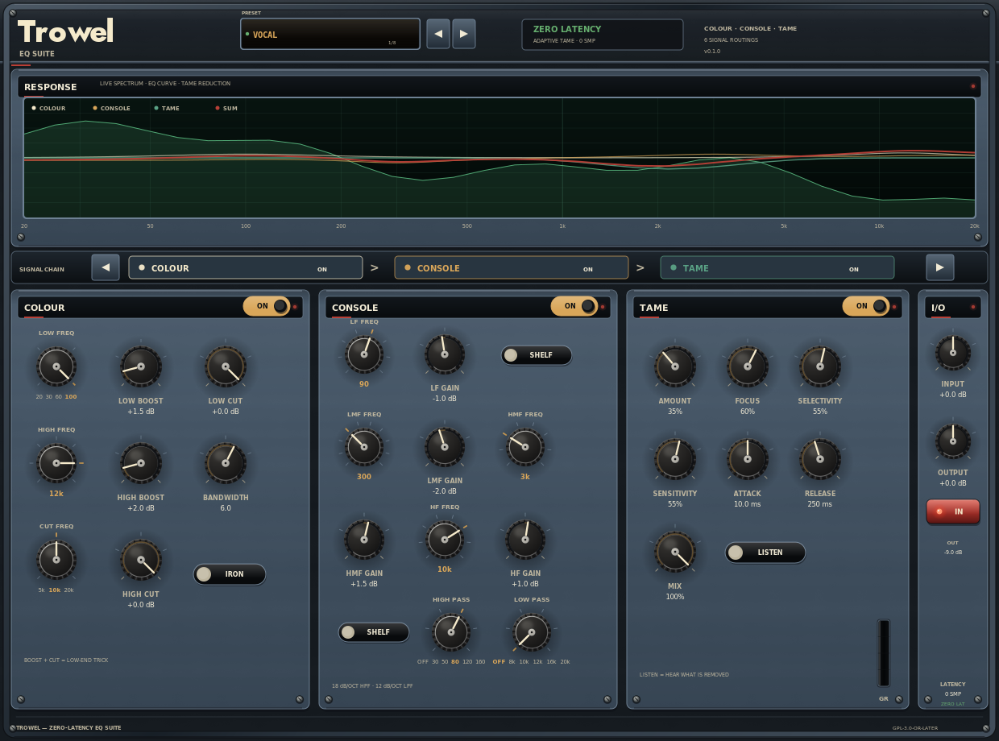
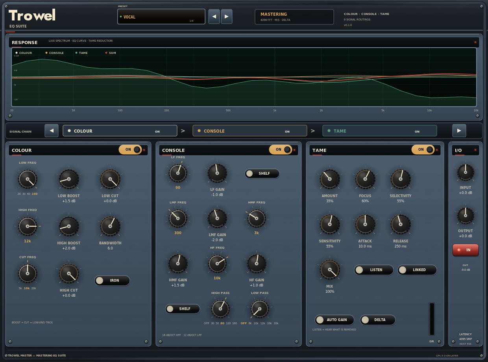

# Trowel

**Version 0.1.0** · GPL-3.0-or-later

**Trowel** is a free, open-source EQ suite for Linux in two builds:

- **Trowel** — the zero-latency strip for tracking and everyday mixing.
- **Trowel Master** — the same strip with a high-resolution spectral Tame and
  mastering utilities.

Both are stereo LV2 and CLAP plugins. They share the same Pultec-style Colour
section, SSL 4000E-style Console section, six signal routings, presets and
interface; only the resonance suppressor and the mastering extras differ.

Trowel is an original implementation, not an emulation or a copy of any specific
product. It is not affiliated with or endorsed by Pulse Techniques, SSL, or any
other manufacturer. The goal is the workflow and tonal family of a flexible
console EQ with a modern resonance suppressor.





## The two builds

| | **Trowel** | **Trowel Master** |
| --- | --- | --- |
| Use | tracking, live, everyday mixing | mix bus, mastering |
| Latency | **0 samples** | **4095 samples** |
| Tame engine | 16-band adaptive dynamic bank | 4096-point spectral STFT |
| Tame resolution | ~1/2 octave | 11.7 Hz bins at 48 kHz |
| Stereo | linked | linked **or M/S** |
| Extras | — | auto-gain, whole-strip delta, scope telemetry |
| Pultec / SSL / routing / UI | identical | identical |

Latency in milliseconds depends on the sample rate:

| Sample rate | Trowel | Trowel Master |
| --- | --- | --- |
| 44.1 kHz | 0 | 92.9 ms |
| 48 kHz | 0 | 85.3 ms |
| 96 kHz | 0 | 42.7 ms |
| 192 kHz | 0 | 21.3 ms |

Trowel Master reports its latency through the LV2 `lv2:reportsLatency` port and
the CLAP latency extension; hosts apply plugin delay compensation. The latency
is fixed regardless of routing, module bypass, or whether Tame is enabled, so
PDC stays stable. Use Trowel when you need zero latency.

## Signal flow

```
In ─▶ Input trim ─▶ [ COLOUR | CONSOLE | TAME ] in any order ─▶ Output trim
   ─▶ +0.2 dBFS soft clip ─▶ bypass/delta ─▶ Out
```

- **Six routings** — every permutation of Colour, Console and Tame, selected
  from the signal-chain bar. Changing the order applies a short fade to avoid
  clicks.
- **Per-module bypass** — click a chain chip to toggle its module; the chip LED
  shows the state.
- **Master bypass** — click-free crossfade, with the dry path delayed to match
  the reported latency.
- **Flat bands are transparent** — a 0 dB bell or shelf is mathematically
  `y = x`, so an unused module adds no phase.

## Colour — Pultec EQP-1A style

A broad, musical low/high section. The low boost and low cut are separate
filters with different corner shapes, so using both at once produces the
classic tight low bump and sub-bass roll-off instead of cancelling.

| Control | Range | Notes |
| --- | --- | --- |
| Low Freq | 20 / 30 / 60 / 100 Hz | Shared by boost and cut |
| Low Boost | 0 … +13.5 dB | Broad resonant lift |
| Low Cut | −17.5 … 0 dB | Shelf an octave below the boost |
| High Freq | 3 / 4 / 5 / 8 / 10 / 12 / 16 kHz | High bell |
| High Boost | 0 … +18 dB | |
| Bandwidth | 0 … 10 | Sharp to broad |
| High Cut Freq | 5 / 10 / 20 kHz | |
| High Cut | −16 … 0 dB | High shelf |
| Iron | On / Off | Gentle transformer high-pass and ADAA saturation |

## Console — SSL 4000E style

A four-band console EQ with stepped frequencies, fixed Q and a switched
high-pass / low-pass. LF and HF can each be a shelf or a bell; the shape switch
crossfades between the two.

| Control | Range |
| --- | --- |
| LF Freq | 30 … 150 Hz, 8 steps |
| LF Gain | ±15 dB |
| LF Shape | Shelf / Bell |
| LMF Freq | 100 Hz … 2 kHz, 10 steps |
| LMF Gain | ±15 dB |
| HMF Freq | 1.5 … 10 kHz, 8 steps |
| HMF Gain | ±15 dB |
| HF Freq | 3 … 16 kHz, 8 steps |
| HF Gain | ±15 dB |
| HF Shape | Shelf / Bell |
| HPF | Off / 30 / 50 / 80 / 120 / 160 Hz, 18 dB/oct |
| LPF | Off / 8 / 10 / 12 / 16 / 20 kHz, 12 dB/oct |

## Tame — resonance suppressor

Both builds expose the same controls; the engine underneath differs.

| Control | Range | Notes |
| --- | --- | --- |
| Amount | 0 … 100 % | Maximum reduction, up to −18 dB |
| Focus | 0 … 100 % | Moves the active range from low-mid to high-mid |
| Selectivity | 0 … 100 % | Broad/gentle to narrow/surgical |
| Sensitivity | 0 … 100 % | How far a peak must stand above the local floor |
| Attack | 1 … 100 ms | |
| Release | 50 … 2000 ms | |
| Mix | 0 … 100 % | Parallel blend |
| Listen | On / Off | Hear only what Tame removes |

At Amount 0 the Tame stage is a delayed copy of its input.

**Trowel's dynamic engine** uses 16 log-spaced bands from 160 Hz to 16 kHz.
Each band compares its own short-term level with the levels two and three bands
away. A narrow peak that stands above the local programme floor is attenuated;
a broad note lifts its neighbours too and is left alone. The detector is
stereo-linked, and idle bands are bit-transparent.

**Trowel Master's spectral engine** uses a 4096-point STFT with a 1024-sample
hop and 75% overlap. A narrow 1/24-octave spectral envelope is compared with a
1/2-octave adaptive baseline; bins that stand above the local floor receive a
smoothed, soft-knee attenuation. Gains are smoothed across frequency and time
before being applied to the complex spectrum and overlap-added back. The result
is much more surgical than the dynamic engine and is intended for the mix bus
and mastering.

## Trowel Master extras

- **Stereo: Linked / M-S** — in M/S mode the Tame stage is matrixed to mid/side,
  the two channels are detected and attenuated independently, then matrixed
  back. Useful for de-harshing the sides without touching the centre.
- **Auto Gain** — slow RMS matching between the delayed dry signal and the
  processed signal, clamped to ±12 dB, frozen below −50 dBFS. The manual Output
  trim remains a separate offset.
- **Delta** — monitors the difference between the delayed dry signal and the
  processed output, so you hear only what the strip is doing.

## Global

| Control | Range | Notes |
| --- | --- | --- |
| Input | ±24 dB | Before the chain |
| Output | ±24 dB | After the chain, before the soft clip |
| Routing | 6 orders | Chain bar |
| Enabled | On / Off | Master bypass |
| Tame Reduction | −60 … 0 dB | Meter / host GR |
| Output Level | −60 … +6 dBFS | Peak meter |

## Interface

- **Response scope** — live spectrum with its own −60…0 dB scale, overlaid with
  the Colour and Console curves, the live Tame reduction curve, and the combined
  response. Module curves are colour-coded: cream for Colour, amber for Console,
  verdigris for Tame, red for the sum.
- **Signal-chain bar** — shows the current order. Click a chip to bypass that
  module; use the arrows to cycle through the six routings.
- **Preset bar** — eight starting points, writable through the UI so they work in
  any host: *Vocal - Air & Tame*, *Drum Bus - Punch*, *Bass - Weight*,
  *Acoustic - Open*, *Mix Bus - Polish*, *Guitar - Bite*, *De-Harsh*, and
  *Broken Trowel*.
- **Same console language as the Hearth family** — brushed metal, recessed
  panels, original knob artwork, glass meters, drag-to-edit knobs, double-click
  reset, scroll wheel, shift-drag fine mode, and a resizable HiDPI layout.

## Build

Requirements:

- Linux, a C++17 compiler, CMake ≥ 3.16
- `lv2` development headers
- `cairo`, `x11` and `freetype2` development headers for the native UI
- `lilv` (tests only)
- `xvfb` and `libXtst` (UI/CLAP tests only)
- CLAP headers are vendored in `third_party/clap` (MIT)

```sh
cmake -S . -B build -DCMAKE_BUILD_TYPE=Release
cmake --build build -j
ctest --test-dir build --output-on-failure
```

Artifacts:

- `build/lv2/trowel.lv2/` — Trowel LV2 bundle (`trowel.so`, `trowelUI.so`)
- `build/lv2/trowel-master.lv2/` — Trowel Master LV2 bundle
- `build/clap/Trowel.clap` and `build/clap/Trowel.resources/`
- `build/clap/TrowelMaster.clap` and `build/clap/TrowelMaster.resources/`

### Install for the current user

```sh
cmake -S . -B build -DCMAKE_BUILD_TYPE=Release \
  -DLV2_DIR="$HOME/.lv2" -DCLAP_DIR="$HOME/.clap"
cmake --build build -j
cmake --install build
```

### Install system-wide

```sh
cmake -S . -B build -DCMAKE_BUILD_TYPE=Release \
  -DLV2_DIR="/usr/lib/lv2" -DCLAP_DIR="/usr/lib/clap"
cmake --build build -j
sudo cmake --install build
```

### UI previews

The UI can be rendered without a host for documentation or layout work:

```sh
cmake --build build --target trowel_ui_preview trowel_master_ui_preview
./build/trowel_ui_preview trowel-ui.png
./build/trowel_master_ui_preview trowel-master-ui.png
```

## Using it

- **Ardour / REAPER / Carla** — rescan plugins after installing. Look for
  **Trowel** and **Trowel Master** under the Hearth/Trowel creator.
- **Latency** — Trowel is zero-latency. Trowel Master reports 4095 samples and
  depends on the host's PDC; do not track through it.
- **Gain reduction** — Tame's reduction is published on the `gr` meter port for
  Ardour's inline display and through `clap.gain-adjustment-metering` for
  REAPER's track meter.
- **Presets** — the in-UI preset bar works in any host; four factory presets are
  also exposed as LV2 preset resources.

## Implementation notes

- **TPT state-variable bells and RBJ shelves.** Bell coefficients are shared by
  both channels; state is per channel. Shelves collapse to an exact identity
  filter at 0 dB, so a flat shelf adds neither gain nor phase.
- **Pultec low interaction.** The low boost is a broad resonant bell and the low
  cut is a shelf one octave lower, which produces the tight low bump and
  sub-bass roll-off rather than a simple tilt.
- **Dynamic Tame.** Sixteen analysis band-passes and sixteen transparent dynamic
  bells. The detector uses local contrast against the bands two and three steps
  away, which avoids a tone hiding between two adjacent bands.
- **Spectral Tame.** 4096-point real FFT, 1024-sample hop, sqrt-Hann analysis and
  synthesis, 75% overlap, COLA reconstruction. The narrow/baseline comparison
  uses prefix sums, so the per-frame cost stays linear.
- **Fixed latency.** The spectral engine is causal and adds 4095 samples. The
  strip delays the dry path by the same amount for Mix, Listen, module bypass
  and master bypass, so the plugin's latency never changes.
- **Reordering.** The six permutations are a single enum; changing it fades the
  output down and back up over 20 ms. No audio is processed in two orders at
  once.
- **Output protection.** A soft clipper with a +0.2 dBFS ceiling is linear below
  −0.9 dBFS and saturates gently above it, so normal programme material is
  untouched. Bypass stays clean.
- **CPU.** On the development machine, 20 seconds of stereo audio at 48 kHz
  with Tame at 60% costs about 0.6–0.9 s (3–4% of one core); at 192 kHz it
  is about 12–16%. The spectral engine is not more expensive than the
  dynamic one at typical settings.
- **Denormal protection.** Filter and detector state is flushed below 1e-20.

## Testing

- `test_dsp.cpp` — latency, bypass transparency, Pultec boost/cut interaction,
  SSL shelves, dynamic and spectral Tame transparency and reduction, and
  spectral latency.
- `host_test.cpp` — loads both LV2 bundles with lilv, checks port counts, UIs,
  presets, reported latency, flat-chain unity, bypass and inline display.
- `ui_host_test.cpp` — embeds each X11 UI under Xvfb, delivers meters/telemetry,
  clicks the preset bar and knobs, checks parameter writeback and captures a
  screenshot.
- `clap_host_test.cpp` — loads each CLAP, checks latency, gain metering, finite
  audio and X11 UI embedding.

## Credits

- The Hearth family wordmark uses **Jost ExtraBold** (SIL Open Font License
  1.1); the license is in `assets/fonts/OFL.txt`.
- The knob artwork and brushed-metal texture come from the Hearth project and
  are original GPL-3.0-or-later assets.
- The CLAP headers in `third_party/clap` are MIT-licensed.

## License

GPL-3.0-or-later. See `LICENSE`.

“Pultec” and “SSL” are trademarks of their respective owners. This project is
an independent original design inspired by classic studio EQ workflows.
